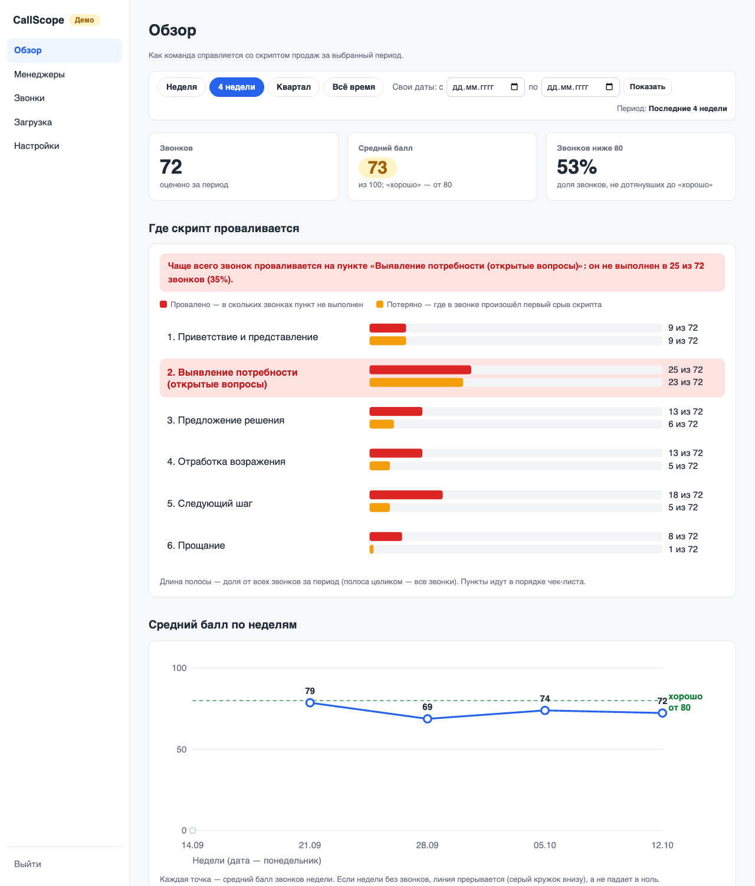
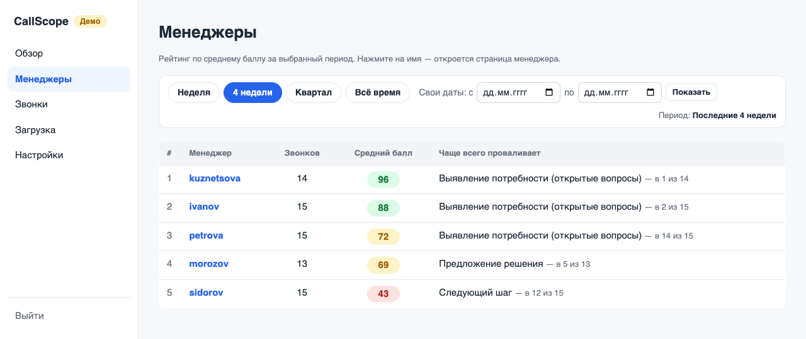
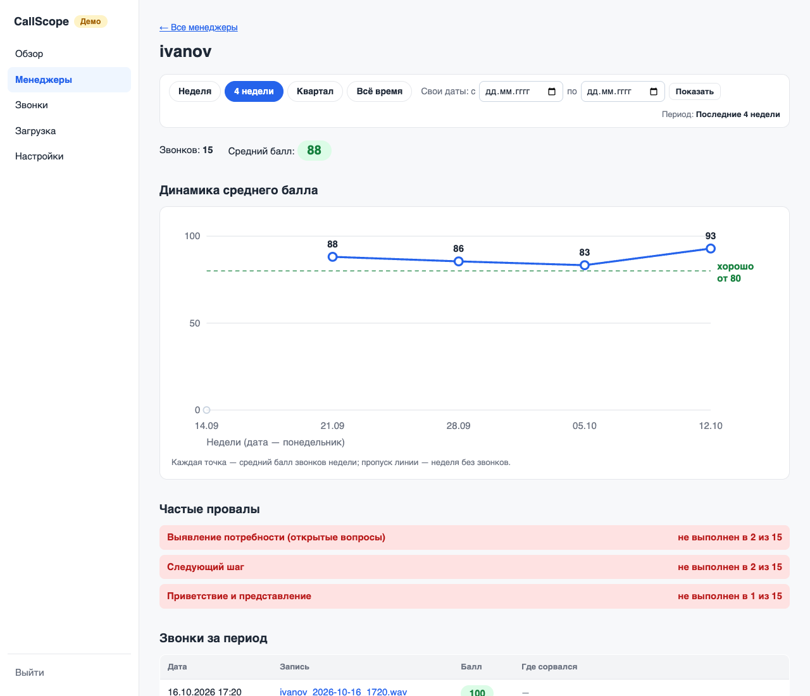
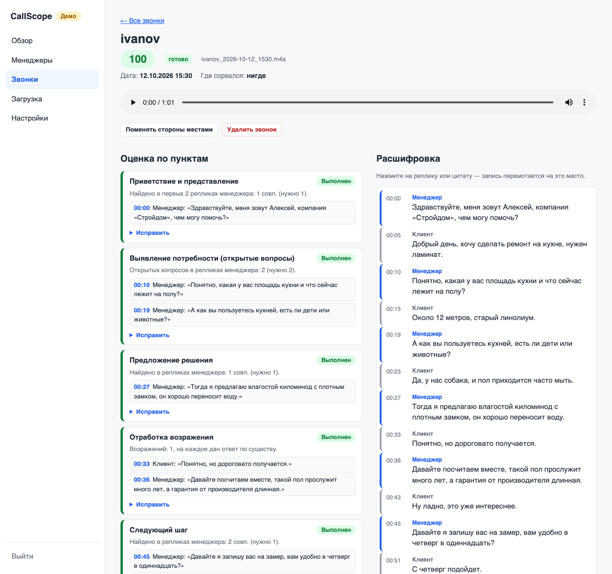
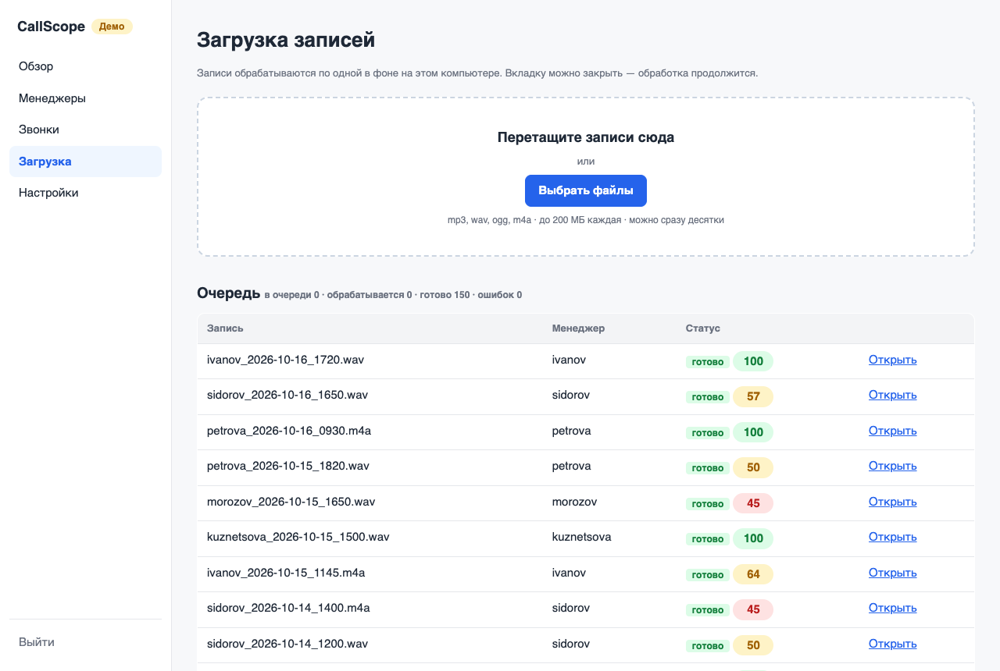
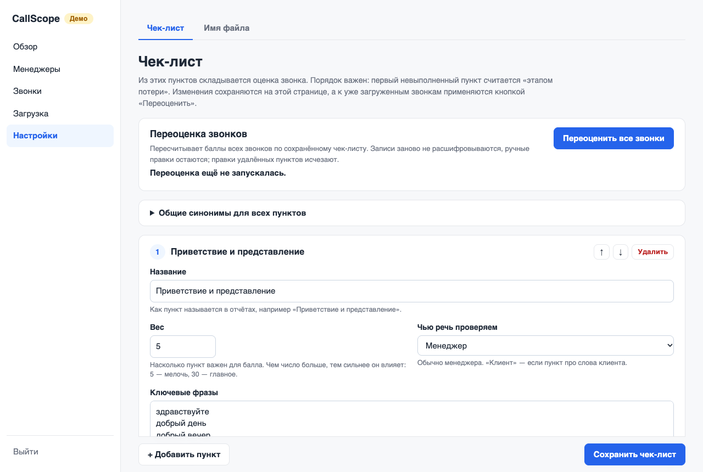
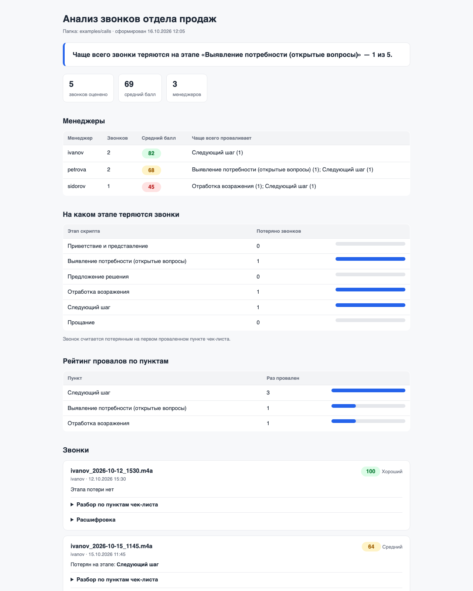

# CallScope — речевая аналитика звонков на своём компьютере

Руководитель отдела продаж не может прослушать сотни звонков, а сервисы речевой
аналитики дорогие и отправляют записи в облако. CallScope решает это локально:
записи расшифровываются и проверяются по чек-листу скрипта продаж на вашем компьютере
или офисном сервере, и видно, кто из менеджеров и на каком этапе теряет клиентов.

Два способа работы:

- **Веб-панель** (`callscope serve` или `docker compose up`) — для руководителя: открыть
  браузер, перетащить записи, посмотреть обзор за неделю или месяц, рейтинг менеджеров,
  послушать спорный звонок и поправить оценку, если машина ошиблась.
- **Консольный отчёт** (`callscope analyze ./calls`) — HTML и Excel по папке с записями,
  [см. ниже](#консольный-отчёт-callscope-analyze).

Расшифровка — [faster-whisper](https://github.com/SYSTRAN/faster-whisper) на процессоре,
записи **никуда не отправляются**. Из интернета один раз скачивается только модель
распознавания (или укажите уже скачанную в `model_path`). Панель не подключает внешних
скриптов и шрифтов — работает в офисе без интернета.

## Как выглядит панель

Скриншоты сделаны в демо-режиме (вымышленная компания «СтройДом», 150 звонков).

**Обзор за период** — сколько звонков, средний балл, доля звонков ниже «хорошо»,
воронка по пунктам чек-листа (где скрипт проваливается чаще всего) и динамика по неделям.



**Менеджеры** — рейтинг за период и самый частый провал каждого.



**Страница менеджера** — динамика, частые провалы, его звонки.



**Звонок** — плеер, расшифровка по ролям (клик по реплике или цитате перематывает запись),
оценка по пунктам с цитатами-доказательствами, ручная правка и комментарий.



**Загрузка** — перетащите записи (mp3, wav, ogg, m4a); они обрабатываются по одной в фоне,
статусы обновляются сами, вкладку можно закрыть.



**Чек-лист** — пункты, веса, ключевые фразы правятся в браузере; «Переоценить все звонки»
пересчитывает баллы без повторной расшифровки. Там же — шаблон имени файла
(как достать менеджера и дату из имени записи).



Ещё в панели: список звонков с фильтрами (период, менеджер, балл, проваленный пункт)
и выгрузка отфильтрованного в Excel.

### Чего в CallScope нет

Намеренно, в этой версии: интеграции с телефонией и CRM (записи загружаются вручную или
командой `callscope import`), нескольких компаний, ролей и аккаунтов менеджеров
(один общий пароль руководителя), уведомлений, мобильного приложения, облачной версии,
дообучения распознавания. HTTPS панель сама не поднимает — см.
[Доступ из сети и HTTPS](#доступ-из-сети-и-https).

## Установка на свой компьютер

Нужны macOS (или Linux) и [uv](https://docs.astral.sh/uv/). Python 3.11+ uv поставит сам,
системный ffmpeg не нужен.

```bash
git clone https://github.com/valer-vm/callscope.git
cd callscope
uv sync
```

> Если в пути к папке проекта есть двоеточие «:» (например, `Programs:scripts/callscope`),
> uv не может создать окружение внутри проекта. Тогда держите окружение вне проекта:
>
> ```bash
> export UV_PROJECT_ENVIRONMENT=$HOME/.cache/callscope-venv
> uv sync
> ```
>
> и задавайте эту переменную перед каждой командой `uv run`.

При первой расшифровке скачивается модель распознавания (`small` — около 500 МБ)
в кэш Hugging Face; дальше программа работает без интернета.

## Первый вход

1. Скопируйте файл настроек и впишите пароль панели:

   ```bash
   cp .env.example .env
   ```

   В `.env` заполните строку `CALLSCOPE_PASSWORD=` — это и есть пароль, который задаётся
   при установке. Остальные строки можно оставить пустыми (пояснения — в самом файле):
   `CALLSCOPE_SECRET_KEY` (ключ подписи сессий; пусто — сгенерируется сам),
   `CALLSCOPE_DATA_DIR` (папка данных, по умолчанию `./callscope-data`),
   `CALLSCOPE_HOST` и `CALLSCOPE_PORT` (по умолчанию `127.0.0.1:8000`).
   Файл `.env` остаётся на этом компьютере, в репозиторий он не попадает.

2. Запустите панель:

   ```bash
   uv run callscope serve
   ```

3. Откройте <http://127.0.0.1:8000> и введите пароль. Сессия живёт 30 дней, «Выйти»
   завершает её и на сервере (скопированная cookie после выхода не работает).
   После 5 неверных попыток вход с этого адреса блокируется на 5 минут.

Пароль меняется в `.env` с перезапуском панели (все открытые сессии при этом закрываются;
то же делает смена `CALLSCOPE_SECRET_KEY`). Изменяющие действия (удаление, правки,
сохранение настроек) принимаются только со страниц самой панели — запрос с другого сайта
получит отказ.
Без пароля панель не запускается и подсказывает, что вписать.

Всё хранится в папке данных: база `callscope.db` (SQLite), записи `audio/`, кэш расшифровок
`cache/`, рабочие `checklist.yaml` и `callscope.yaml` (при первом запуске копируются из
встроенных). Резервная копия — копия этой папки при остановленной панели.

Флаги: `callscope serve [--host 127.0.0.1] [--port 8000] [--data-dir ПАПКА] [--demo]`.

## Демо-режим

Посмотреть панель с данными, ничего не загружая:

```bash
uv run callscope demo            # создаёт ./callscope-data-demo: 150 звонков за 8 недель
uv run callscope serve --demo    # открывает демо-базу (пароль — тот же из .env)
```

Демо-база отдельная, рабочие данные она не трогает. Пять звонков в ней — с настоящим аудио
из `examples/calls/` (их можно послушать и перематывать по цитатам); у остальных записи нет —
на их странице вместо плеера пометка «Записи разговора нет», расшифровка и оценки на месте.
Пересоздать: `uv run callscope demo --force` (удаляет только базу, созданную этой командой).

## Импорт папки с записями

Вместо перетаскивания в браузере можно поставить в очередь всю папку:

```bash
uv run callscope import ./calls
```

Уже загруженные записи (по содержимому файла) пропускаются; расшифровки, сделанные раньше
`callscope analyze`, берутся из его кэша. Если панель запущена, она обработает очередь сама;
если нет — при следующем запуске. Папка не отслеживается — импорт запускается по команде.

## Установка на офисный сервер через Docker

Нужны Docker и Docker Compose (на macOS подойдёт [colima](https://github.com/abiosoft/colima):
`brew install colima docker docker-compose && colima start`; если `docker compose` не
находит плагин, пишите `docker-compose` — команды те же).

```bash
git clone https://github.com/valer-vm/callscope.git
cd callscope
cp .env.example .env          # впишите CALLSCOPE_PASSWORD
docker compose up -d --build
```

Панель — `http://<адрес сервера>:8000`. Образ — `python:3.12-slim` + uv, без ffmpeg.
Данные лежат в именованном томе `callscope-data`, модель распознавания — в томе `hf-cache`:
она скачивается один раз при первой обработке записи (около 500 МБ), после перезапуска
и обновления образа — уже не качается. В образ не попадают `.env` и данные: пароль
передаётся через `env_file` при запуске.

```bash
docker compose logs -f                      # журнал панели
docker compose down                         # остановить (данные в томах сохраняются)
git pull && docker compose up -d --build    # обновить
docker compose run --rm -v /путь/к/записям:/import:ro callscope callscope import /import
```

Последняя команда — импорт папки с сервера в очередь панели.

## Доступ из сети и HTTPS

> **Внимание.** Панель говорит по обычному HTTP. По умолчанию (`127.0.0.1`) она доступна
> только с этого компьютера. Если открыть её в сеть (`CALLSCOPE_HOST=0.0.0.0` или Docker),
> пароль и записи идут по сети незашифрованными — любой в той же сети может их перехватить.
> Для доступа с других компьютеров поставьте перед панелью обратный прокси с HTTPS.

Рецепт с [Caddy](https://caddyserver.com/) (сам выпускает сертификаты). Панель оставьте
на `127.0.0.1:8000` (в Docker — замените в `docker-compose.yml` порт на
`"127.0.0.1:8000:8000"`), а Caddy — единственный, кто слушает сеть. `Caddyfile`:

```
callscope.office.lan {
    tls internal             # свой сертификат для внутренней сети
    reverse_proxy 127.0.0.1:8000
}
```

Для имени, доступного из интернета, уберите строку `tls internal` — Caddy получит
сертификат Let's Encrypt. Запуск: `caddy run --config Caddyfile`. С `tls internal` браузеры
предупредят о неизвестном издателе, пока корневой сертификат Caddy (`caddy trust`)
не установлен на компьютерах пользователей.

За прокси панель по умолчанию видит все входы с одного адреса — адреса прокси, и
блокировка после 5 неверных паролей действовала бы сразу для всех. Укажите адрес прокси в
`.env`, тогда панель возьмёт настоящий адрес из заголовка `X-Forwarded-For` (Caddy ставит
его сам):

```
CALLSCOPE_TRUSTED_PROXIES=127.0.0.1
CALLSCOPE_COOKIE_SECURE=1     # cookie входа — только по HTTPS
```

В Docker без прокси клиенты могут быть видны с внутреннего адреса Docker (шлюз сети);
если блокировка срабатывает для всех сразу, укажите этот адрес в
`CALLSCOPE_TRUSTED_PROXIES` или поставьте прокси, как выше. Не задавайте
`CALLSCOPE_TRUSTED_PROXIES` без прокси: тогда адрес клиента можно подделать.

## Консольный отчёт (`callscope analyze`)

Отчёт по папке с записями без панели — как в первой версии.



Пример готового отчёта — [`examples/report/report.html`](examples/report/report.html)
и [`examples/report/report.xlsx`](examples/report/report.xlsx), построен по тестовым
звонкам из [`examples/calls/`](examples/calls/).

```bash
uv run callscope analyze ./calls
```

Программа берёт из папки все записи mp3, wav, ogg, m4a (без вложенных папок, регистр
расширения не важен), показывает прогресс по файлам и по текущей записи и в конце
печатает путь к отчёту: `reports/<ГГГГ-ММ-ДД_ЧЧММ>/report.html` и `report.xlsx`.
Старые отчёты не затираются — повторный запуск в ту же минуту получит суффикс `_2`.

Попробовать на тестовых звонках:

```bash
uv run callscope analyze examples/calls
```

Повторный запуск не расшифровывает записи заново: расшифровки хранятся в
`.callscope-cache/` внутри анализируемой папки (ключ — содержимое файла и модель).
Изменение чек-листа кэш не сбрасывает — можно править `checklist.yaml` и сразу
перезапускать.

| Флаг | Что делает |
|---|---|
| `--out DIR` | куда складывать отчёты (по умолчанию `reports/`) |
| `--config FILE` | другой файл настроек вместо `./callscope.yaml` |
| `--checklist FILE` | другой чек-лист вместо `./checklist.yaml` |
| `--model SIZE` | модель распознавания: `tiny`, `base`, `small`, `medium`, `large-v3` |
| `--manager-channel auto\|left\|right` | сторона менеджера в стерео-записи вручную |
| `--semantic / --no-semantic` | смысловая перепроверка провалов локальной Ollama |
| `--no-cache` | расшифровать заново, не глядя в кэш |

Коды выхода: `0` — отчёт построен; `1` — в папке нет записей или ни одну не удалось
обработать (отчёт не создаётся); `2` — ошибка ввода: нет папки, ошибка в
`callscope.yaml` или `checklist.yaml` (проверяется до расшифровки).

Файл, который не читается, пропускается с предупреждением; остальные звонки
анализируются, а список пропущенных есть в отчёте.

## Настройка отчёта

Оба файла ищутся в текущей папке; если их нет, берутся встроенные значения по умолчанию
(их копии — `callscope.yaml` и `checklist.yaml` в корне репозитория).

### `callscope.yaml`

```yaml
filename_template: "{manager}_{date}_{time}"   # ivanov_2026-10-12_1530.mp3
date_format: "%Y-%m-%d"
time_format: "%H%M"
model_size: small            # tiny, base, small, medium, large-v3
model_path: null             # папка уже скачанной модели — без выхода в сеть
manager_channel: auto        # auto, left, right
manager_channel_overrides:   # сторона менеджера для отдельных файлов
  smirnov_2026-10-20_1000.mp3: right
intro_phrases: [меня зовут, вас беспокоит, компания]
company_names: [СтройДом]    # впишите название своей компании
mono_turn_gap: 0.8           # моно: смена говорящего на паузе ≥ 0,8 с
thresholds: {good: 80, medium: 50}
semantic: {enabled: false, url: "http://localhost:11434", model: "qwen2.5:7b"}
```

Имя менеджера и дата берутся из имени файла по шаблону (`{manager}`, `{date}`, `{time}`,
`{any}`). Не подошло — менеджер «Не определён», звонок всё равно анализируется.
Менеджером считается сторона, которая первой представилась от имени компании
(`intro_phrases`, `company_names`); если никто не представился — тот, кто заговорил первым.

### `checklist.yaml`

Пункты идут в порядке этапов скрипта: первый проваленный пункт — «этап потери» звонка.
Фразы ищутся по начальным формам слов («предложу» = «предлагаю»), поэтому достаточно
одной формы. Пример пункта:

```yaml
items:
  - id: next_step
    title: Следующий шаг
    weight: 25                 # вес в итоговом балле
    phrases: [встреча, отправлю вам, я перезвоню]
    statement_phrases: [замер, счет, договор] # не в вопросе и без «не»
    synonyms:
      замер: [выезд на объект] # слово → замены
    window: all                # all, first, last — где искать
    min_matches: 1             # сколько разных реплик должны совпасть
    description: Менеджер договаривается о конкретном следующем шаге.
```

Ещё два вида правил: `rule: open_questions` (открытые вопросы, начинающиеся с
вопросительного слова из `phrases`) и условный пункт с `trigger` — например,
«возражение» проверяется, только если клиент сказал «дорого», «подумаю» и т.п.;
иначе пункт «не применим» и в балл не входит. Описание всех полей — в комментариях
`checklist.yaml`. Ошибка в файле — сообщение с номером пункта и полем, код выхода 2.

Балл звонка = сумма весов выполненных пунктов / сумма весов применимых × 100.
От 80 — хороший, от 50 — средний, ниже — плохой (пороги в `callscope.yaml`).

## Тестовые звонки

В `examples/calls/` лежат пять сгенерированных звонков вымышленной компании «СтройДом»:
два хороших, без выявления потребности, с проваленным возражением и без следующего шага.
Менеджер — в левом канале, клиент — в правом. Пересоздать их (только macOS, встроенные
`say` и `afconvert`):

```bash
uv run python scripts/generate_examples.py --out examples/calls
```

Диалоги и ожидаемый результат — в `scripts/dialogues.yaml`.

## Ограничения точности и как их улучшить

- **Телефонное качество.** Запись 8 кГц, шум и сжатие ухудшают распознавание: слова
  искажаются («влагостойкий ламинат» → «влагостой киломинод»), теряются знаки вопроса.
  Проверка опирается на ключевые фразы, поэтому искажённая фраза может не найтись.
  *Улучшить:* записывать звонки в лучшем качестве, по возможности — в стерео.
- **Моно-записи.** Если оба собеседника в одном канале, стороны различаются по голосу:
  тембр и высота тона каждого куска речи, простая кластеризация без нейросетей. На
  тестовых звонках, сведённых в моно, стороны определены верно для 98–100% речи, если
  голоса различаются, и только для ~65%, если голоса очень похожи (тогда программа
  откатывается к правилу «смена стороны на паузе ≥ `mono_turn_gap` или после вопроса»).
  Такие звонки помечены в отчёте «стороны определены приблизительно». *Улучшить:*
  включить в АТС запись в стерео (менеджер и клиент в разных каналах) — это самый
  большой выигрыш; или использовать нейросетевую диаризацию (например, pyannote) —
  в CallScope её нет намеренно: она тяжёлая и требует токенов.
- **Размер модели.** `small` быстрый (минутный звонок — около 7 с на процессоре),
  но ошибается чаще. `medium` и `large-v3` точнее и в разы медленнее:
  `uv run callscope analyze ./calls --model medium`.
- **Ключевые фразы.** Проверка без нейросети находит только то, что есть в списке фраз.
  Whisper пишет числа цифрами («20», «10%»), название компании слитно или раздельно
  («Стройдом», «Строй дом»). *Улучшить:* после первого прогона откройте расшифровки
  в отчёте и добавьте в `checklist.yaml` фразы и синонимы, которые реально говорят
  ваши менеджеры; для смысловой проверки провалов включите локальную Ollama
  (`--semantic`), она перепроверяет только проваленные пункты и требует цитату.
- **Многозначные слова и отрицания.** Слова ищутся по начальным формам, а отрицание
  («скидок нет») распознаётся простыми правилами, поэтому необычный оборот может
  засчитаться не так. Проверяйте цитату-доказательство у пункта — она всегда в отчёте.

## Разработка

```bash
uv run ruff check src tests scripts && uv run pytest -q
```

Тесты не требуют модели, аудио и сети. Медленные тесты (нужна модель whisper в кэше):

- `CALLSCOPE_SLOW=1 uv run pytest tests/test_asr.py -q` — настоящая модель и голос `say`;
- `CALLSCOPE_SLOW=1 uv run pytest tests/test_e2e_upload.py -q -s` — сквозная проверка панели:
  `callscope serve` в фоне, 20 записей через `/api/upload`, время ответа страниц во время
  обработки, дубликат, перезапуск сервера посреди очереди.

Скриншоты для README пересоздаются из демо-режима (нужен Google Chrome):
`uv run python scripts/screenshots.py`.

## Лицензия

[MIT](LICENSE)
