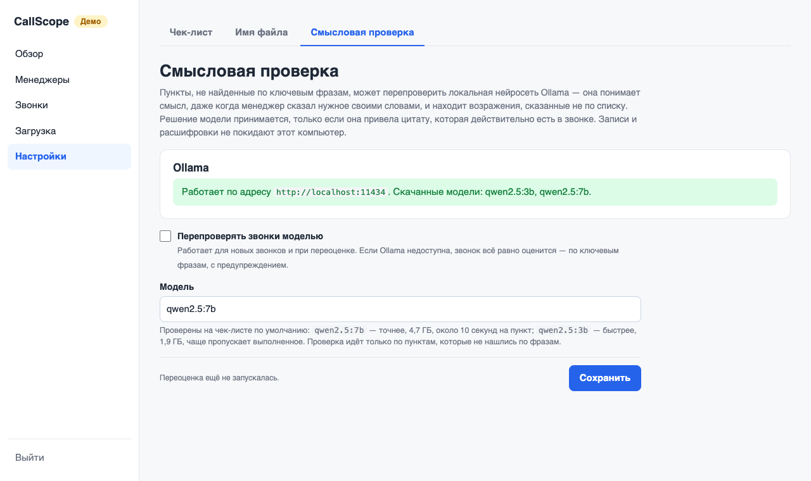

# Установка CallScope у клиента

Пошаговая инструкция для того, кто ставит CallScope в компании клиента: от пустого
компьютера до панели, в которой руководитель смотрит оценки звонков. На установку уходит
30–60 минут, большая часть — ожидание скачивания.

Подробности по каждой настройке — в [INSTALL.md](INSTALL.md) и [CONFIG.md](CONFIG.md); здесь только порядок действий.

## 1. Что понадобится

| | Без смысловой проверки | Со смысловой проверкой |
|---|---|---|
| Компьютер | любой современный, видеокарта не нужна | то же |
| Память | от 8 ГБ | от 16 ГБ |
| Свободное место | ~3 ГБ + записи звонков | ~10 ГБ + записи звонков |
| Интернет | только на время установки | то же |
| Скорость | минута звонка — ~8 с | плюс ~10 с на каждый невыполненный пункт |

После установки CallScope работает без интернета: записи и расшифровки не покидают
компьютер клиента.

Ещё нужно заранее узнать у клиента:

- **Как называются файлы записей** — например, `ivanov_2026-10-12_1530.mp3`. Из имени
  берутся менеджер и дата звонка.
- **Название компании так, как его говорят менеджеры**, — по нему программа понимает,
  кто в разговоре менеджер.
- **Скрипт продаж** — какие этапы должен пройти менеджер. По нему настраивается чек-лист.
- **Пишет ли телефония звонки в стерео** (менеджер и клиент в разных каналах). Если да,
  стороны разговора определяются почти без ошибок.

## 2. Какой вариант выбрать

- **Офисный сервер или отдельный компьютер (Docker)** — рекомендуется. Панель работает
  постоянно, руководитель и другие сотрудники открывают её в браузере со своих компьютеров.
- **Компьютер руководителя (macOS или Linux)** — если CallScope нужен одному человеку.

Проверено на macOS (Apple Silicon) и в Docker (Linux). На Windows напрямую не проверялось;
через Docker Desktop должно работать так же, как на Linux, но тоже без проверки.

## 3. Вариант А: офисный сервер (Docker)

**3.1. Поставить Docker.** На Linux-сервере — Docker Engine и Docker Compose по инструкции
с docker.com. На Mac:

```bash
brew install colima docker docker-compose
```

```bash
colima start
```

Если команда `docker compose` пишет, что не знает `compose`, используйте `docker-compose`
(через дефис) — дальше все команды те же.

**3.2. Скачать CallScope и задать пароль.**

```bash
git clone https://github.com/valer-vm/callscope.git
```

```bash
cd callscope && cp .env.example .env
```

Откройте файл `.env` в любом текстовом редакторе и впишите пароль панели в строку
`CALLSCOPE_PASSWORD=`. Этот пароль вы передадите руководителю.

**3.3. Запустить.** Без смысловой проверки:

```bash
docker compose up -d --build
```

Со смысловой проверкой (дополнительно скачается ~5 ГБ, это займёт 5–20 минут):

```bash
docker compose --profile semantic up -d --build
```

Через минуту-две панель откроется по адресу `http://<адрес сервера>:8000`. Проверить,
что всё запустилось, — в списке должно быть `healthy`:

```bash
docker compose ps
```

**3.4. Защитить доступ.** Панель говорит по обычному HTTP: в общей сети пароль и записи
можно перехватить. Если панель открывают не только с самого сервера, поставьте перед ней
HTTPS-прокси — готовый рецепт в [INSTALL.md](INSTALL.md#доступ-из-сети-и-https).

## 4. Вариант Б: компьютер руководителя (macOS или Linux)

**4.1. Поставить uv** (он сам скачает нужный Python):

```bash
curl -LsSf https://astral.sh/uv/install.sh | sh
```

Закройте и снова откройте окно терминала.

**4.2. Скачать CallScope.**

```bash
git clone https://github.com/valer-vm/callscope.git
```

```bash
cd callscope && uv sync && cp .env.example .env
```

Впишите пароль в строку `CALLSCOPE_PASSWORD=` файла `.env`.

**4.3. Запустить.**

```bash
uv run callscope serve
```

Панель откроется по адресу <http://127.0.0.1:8000>. Пока окно терминала открыто, панель
работает; закрыли — остановилась. Записи и оценки сохраняются в папке `callscope-data`.

**4.4. Смысловая проверка (по желанию).** Поставить Ollama и скачать модель:

```bash
brew install ollama && brew services start ollama
```

```bash
ollama pull qwen2.5:7b
```

На Linux Ollama ставится установщиком с сайта ollama.com.

## 5. Первый вход и проверка

1. Откройте адрес панели и введите пароль из `.env`.
2. Откройте «Загрузка» и перетащите 2–3 записи клиента.


3. Первая запись обрабатывается дольше: один раз скачивается модель распознавания
   (~500 МБ, 1–3 минуты). Дальше — около 8 секунд на минуту разговора.
4. Откройте готовый звонок и проверьте:
   - менеджер и дата взяты из имени файла верно;
   - реплики менеджера и клиента не перепутаны (если перепутаны — кнопка «Поменять
     стороны местами»);
   - в расшифровке узнаётся разговор.


## 6. Настройка под клиента

**Имя файла.** «Настройки» → «Имя файла»: впишите шаблон, нажмите «Проверить» на примере
настоящего имени и сохраните. Менеджер и дата пересчитаются у всех звонков.

**Чек-лист.** «Настройки» → «Чек-лист»: этапы скрипта продаж, их вес в баллах и фразы,
по которым программа находит этап в разговоре. Откройте 3–5 расшифровок, посмотрите,
как менеджеры говорят на самом деле, и добавьте эти фразы. После сохранения нажмите
«Переоценить все звонки» — записи заново не расшифровываются.


**Название компании** нужно, чтобы программа узнавала менеджера по фразе «компания …»
в начале разговора. Оно хранится в файле `callscope.yaml` в папке данных, строка
`company_names`. На компьютере руководителя это файл `callscope-data/callscope.yaml`.
В Docker файл достаётся из контейнера, правится и кладётся обратно:

```bash
docker compose cp callscope:/data/callscope.yaml ./callscope.yaml
```

```bash
docker compose cp ./callscope.yaml callscope:/data/callscope.yaml
```

Пишите название так, как его распознаёт программа: посмотрите в расшифровке, как оно
записано («Стройдом» или «Строй дом»), и впишите оба варианта.

**Смысловая проверка.** «Настройки» → «Смысловая проверка»: там видно, работает ли Ollama
и какая модель скачана. Отметьте «Перепроверять звонки моделью» и сохраните.



## 7. Как руководитель работает с панелью

- **Загрузка** — перетащить записи за день или неделю; обработка идёт в фоне, вкладку
  можно закрыть.
- **Обзор** — средний балл, на каком этапе чаще всего теряются звонки, динамика по неделям.
- **Менеджеры** — сравнение менеджеров и их частые ошибки.
- **Звонки** — список с фильтрами и выгрузкой в Excel; на странице звонка — запись,
  расшифровка и почему каждый пункт засчитан или нет. Если руководитель не согласен
  с оценкой пункта, он меняет её вручную.


## 8. Обслуживание

**Резервная копия.** На компьютере руководителя — скопировать папку `callscope-data`,
пока панель остановлена. В Docker — остановить панель, скопировать данные и запустить снова
(панель недоступна несколько секунд):

```bash
docker compose stop callscope
```

```bash
docker compose cp callscope:/data ./callscope-backup
```

```bash
docker compose start callscope
```

**Обновление до новой версии.**

```bash
git pull && docker compose up -d --build
```

На компьютере руководителя — `git pull`, затем `uv sync` и запуск заново.

**Смена пароля.** Поменять строку `CALLSCOPE_PASSWORD` в `.env` и перезапустить панель.
В Docker перезапуск — `docker compose up -d --force-recreate`.

**Панель не открывается.**

- Docker: `docker compose ps` — контейнер должен быть `healthy`; журнал —
  `docker compose logs --tail 50 callscope`.
- Компьютер руководителя: смотрите сообщение в окне терминала. Без пароля в `.env`
  панель не запускается и пишет, что вписать.
- Забыли пароль — он в файле `.env` на сервере.

## 9. Перед тем как отдать клиенту

- [ ] Панель открывается по адресу, пароль передан руководителю.
- [ ] Шаблон имени файла проверен на настоящих записях.
- [ ] Название компании вписано, стороны в 3–5 звонках определены верно.
- [ ] Чек-лист настроен под скрипт продаж и переоценён.
- [ ] Если панель открывают по сети — настроен HTTPS.
- [ ] Руководитель знает, где резервная копия и как загружать записи.
